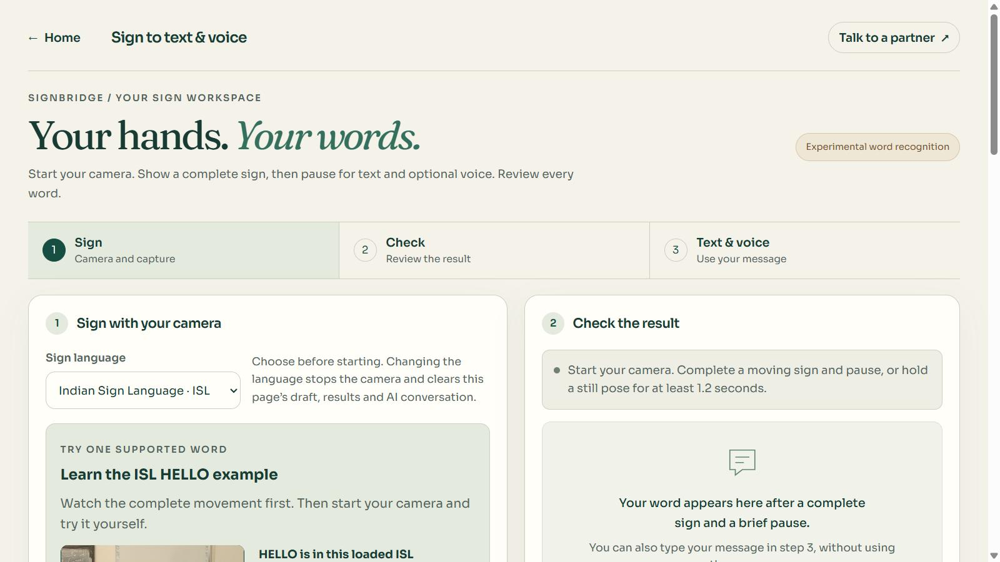

# Capture provenance and local restart — 22 October 2026

The working checkout is now `F:\Downloads\signbridge`. Both local services were restarted successfully from that directory: the web app on port 5174 and rooms on port 3001. The existing launcher already resolves its own directory; no launcher change was needed for the move. `F:\Downloads\signbridge-fixed\signbridge` is an older starter and is not the current application.

This update improves the evidence saved for future training. **It does not train a new model or establish working webcam sign translation.** The two candidates in the [13 October video study](tasks-video-training-results-2026-10-13.md) failed the recorded reliability requirements. The active model and acceptance thresholds remain unchanged.

## What changed

Every new live Tasks Holistic frame can carry an optional `captureContext` with the actual decoded `videoWidth` and `videoHeight`. The remaining fields identify the current capture contract:

```json
{
  "format": "signbridge-capture-context-v1",
  "tracker": "mediapipe-tasks-holistic",
  "modelAsset": "holistic_landmarker/float16/1",
  "delegate": "CPU",
  "runningMode": "VIDEO",
  "coordinateSpace": "normalized-image",
  "sampleIntervalMs": 125,
  "mirrorApplied": false,
  "width": 640,
  "height": 480
}
```

The dimensions above illustrate a possible camera fallback, not a new measured webcam result. A request for 1280×720 does not establish the delivered size. Sign Workspace and the nonsigning recorder now both request the same preferred widescreen format; either can receive a different size. The record uses the decoded source size. `sampleIntervalMs` is the configured sampling cap, not proof of achieved frame rate; the existing frame timestamps retain measured timing. `mirrorApplied: false` describes tracker input; the visible camera preview may be mirrored with CSS.

Manual sign captures, automatic moving/still captures, and the explicit nonsigning recorder preserve this metadata through detached frame copies, consented local storage and JSON export. Nothing is saved or trained automatically. No raw video, audio, device identifier or participant identity was added to the record. The existing anonymous signer/session codes and explicit consent remain required.

The Python importer validates the same field whitelist and preserves it in raw-pose exports. Its scalar inventories report complete, partial and legacy samples and distinct capture contexts. If a language collection contains recorded context, a missing/partial context or more than one pipeline/geometry identity blocks training-array creation with an explanation. Entirely legacy collections keep their existing behavior; absent context is never guessed or backfilled. Such legacy compatibility is not evidence that those samples have a verified capture domain.

Context fields are source assertions, not independent proof of physical-camera use, detector execution, signer identity, valid labels or sign accuracy. Different capture domains need a declared preprocessing/evaluation decision before combining them; deleting metadata to bypass the check would defeat its purpose.

## Verification

- Regression coverage checks the actual-size fallback, detached frame copies, manual/automatic/nonsigning save paths, IndexedDB export, malformed context, legacy preservation, partial/mixed import blocking and JavaScript/Python validation parity.
- The existing tracker test mocks now supply both video dimensions and expect the new third callback argument. This repairs outdated fixtures rather than bypassing the geometry check.
- The restarted browser page loaded the 49-word local ISL model and the HELLO reference. A read-only check against the decoded reference reported 1920×1088 and the new factory preserved that exact size. The reference was not used for a new model evaluation. The camera remained off during this check.
- Final `npm run check` passed: 382 Node tests, 512 UI tests across 39 files, and the local production/PWA build. Full Python discovery passed 252 tests. The final `npm run build:public` passed and `dist/models` was absent; the build still reports its existing large-JavaScript-chunk warning. These software checks are separate from physical-camera recognition and audible playback, neither of which was established by this update.



The screenshot shows the running application and practice reference availability. It is not evidence of successful sign recognition.

Active ISL SHA-256 remains `55c23fffe387944a102c804676ae91aa7276781d598b7adaf03f0115234acdd9`. Existing frozen study protocols, examined test sets and candidate artifacts were not modified or reused for another fitting run. No model promotion or deployment was performed.

## Run and collect the missing evidence

From `F:\Downloads\signbridge`, double-click `start-signbridge.cmd`, or run:

```powershell
powershell.exe -NoProfile -ExecutionPolicy Bypass -File scripts/start-local.ps1 -NoBrowser
```

Open [Sign Workspace](http://127.0.0.1:5174/#trained-sign) for supported-word practice or [Training Studio](http://127.0.0.1:5174/#training-studio) for consented sample inventory/export. The existing samples stay in the same browser origin's local storage; moving the source directory does not migrate data between browsers.

The next useful training inputs are verified ISL examples captured through the current camera flow, plus explicitly attested ordinary movement. A person who does not know sign language can collect the latter using **Record no-sign examples**. A failed guess or imitation alone does not establish a correct word label. Start with a small verified vocabulary and stable anonymous signer codes, and keep at least one person and later sessions out of fitting. Define the evaluation before inspecting those held-out outcomes. Saving/exporting examples does not retrain the app.

New captures with mixed sizes should be reviewed and recaptured in a consistent setup, or evaluated under a separately declared normalization study. Do not manufacture missing capture metadata for older recordings.

Verification commands:

```powershell
npm run check
.training-venv/Scripts/python.exe -B -m unittest discover -s training -p 'test_*.py'
npm run build:public
```

Local logs: `.training-data/replay/capture-context-check-2026-10-22.log`, `.training-data/replay/capture-context-python-2026-10-22.log`, and `.training-data/replay/capture-context-public-build-2026-10-22.log`. Run the public build last so `dist` excludes local research models.

Earlier study reports retain the absolute `C:` paths recorded when those studies ran. Their files are now under the equivalent `F:\Downloads\signbridge` location; those frozen records were not rewritten merely to change paths.
