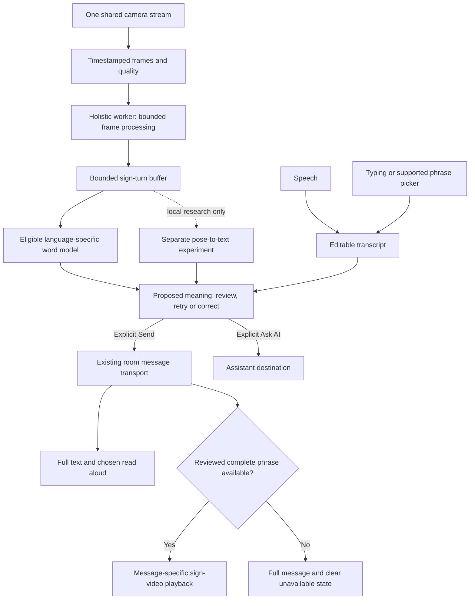

# SignBridge: deeply researched implementation plan

**10 October 2026 — proposed work, not completed implementation.** This plan builds on the [project research](C:/Users/adjay/Downloads/signbridge/docs/project-research-2026-10-10.md), checks the actual source contracts, and adds a newly found September 2026 ISL sentence-model candidate. No model was downloaded or executed for this plan. Public model metadata and small source files were inspected; private credentials, recordings and final-test arrays were not read.

**Implementation update:** the urgent local reference text/voice demo and camera recovery controls are implemented and separately measured in the [advisor demo record](C:/Users/adjay/Downloads/signbridge/docs/advisor-demo-2026-10-10.md). The training, shared catalogue and sentence-model work packages below remain proposed; the demo does not complete them or establish live signing accuracy.

## Intended result and scope

A signer opens one conversation screen, uses the camera to produce a supported sign turn, checks its proposed meaning and sends it. Their partner receives the full message as text and optionally hears it. The partner speaks or types a reply; a complete reviewed sign-video reply plays when the catalogue supports that meaning. Both participants can replay, correct and ask for repetition.

The first release supports **10–20 explicitly listed ISL word meanings and approximately 10–15 complete reply phrases**, subject to usable data, rights and fluent review. These are scope targets, not an already selected vocabulary. ASL stays selectable for direct video and existing tools, with separate model and content eligibility. There is no automatic language substitution.

Two research lanes serve the larger goal:

- **Release lane:** compatible data → measured isolated-word recognition → reviewed human messages → complete-phrase replies → physical-device evidence.
- **Bounded sentence lane:** audit and test an available ISL pose-to-text checkpoint offline. It can become an experimental turn translator only after input, meaning and runtime checks. It does not block the release lane or become a promised month-one capability.

The target interaction can become easier and more immediate while recognition remains reviewed. Sending a guessed sentence automatically would undermine the communication goal.

## 1. What should be reused, and what is actually missing?

| Existing source | Verified state | Implementation consequence |
| --- | --- | --- |
| [RoomSignCapture.jsx](C:/Users/adjay/Downloads/signbridge/src/components/RoomSignCapture.jsx) | Borrows the room's camera; explicit capture/finish; bounded samples and duration; tentative review. | Extend the existing flow. Do not create a second camera owner or another conversation screen. |
| [usePoseTracking.js](C:/Users/adjay/Downloads/signbridge/src/hooks/usePoseTracking.js), [poseTracker.js](C:/Users/adjay/Downloads/signbridge/src/lib/poseTracker.js) | Holistic CPU detection is synchronous on the UI thread, capped at eight samples/s. Callback time is recorded after detection. | Add source timestamps and measured stage timings; prototype a tracking worker with bounded work. Eight Hz is a cap, not measured throughput. |
| [prepare_graph_data.py](C:/Users/adjay/Downloads/signbridge/training/prepare_graph_data.py) | Rebuilds 75-joint historical features, but normalises original XY without the newly audited canonical conversion. | Add a separate canonical preparer; preserve frozen historical outputs. |
| [train_temporal_baseline.py](C:/Users/adjay/Downloads/signbridge/training/train_temporal_baseline.py) | Matched GRU75/LSTM75 training already exists. Requires coordinate declaration and valid signer partitions. | Reuse it. New data and a complete evaluation/promotion path are needed. |
| [import_samples.py](C:/Users/adjay/Downloads/signbridge/training/import_samples.py) | Validates collected samples, consent/signer/session information and split rules, but exports 27-joint features. | Add an explicit 75-joint output path. Existing collections do not automatically fit the temporal runner. |
| [graphSignModel.js](C:/Users/adjay/Downloads/signbridge/src/lib/graphSignModel.js), [export_graph_model.py](C:/Users/adjay/Downloads/signbridge/training/export_graph_model.py) | Existing ONNX loader/export has strict contracts and promotion gates. A successful LSTM native export is not a browser release. | Introduce a separately versioned temporal artifact and evidence-backed promotion; never edit gate booleans by hand. |
| [signVideos.js](C:/Users/adjay/Downloads/signbridge/src/lib/signVideos.js), [useSignVideos.js](C:/Users/adjay/Downloads/signbridge/src/hooks/useSignVideos.js) | Video blobs exist only in one browser's IndexedDB. Matching removes punctuation. | Add a separate shared complete-phrase catalogue with stronger meaning identity. Keep personal recordings separate. |
| [SignVideoPlayer.jsx](C:/Users/adjay/Downloads/signbridge/src/components/SignVideoPlayer.jsx), [ConnectMode.jsx](C:/Users/adjay/Downloads/signbridge/src/modes/ConnectMode.jsx) | Latest-message playback and dictionary coverage exist; no common reviewed content library or historical-message sign replay. | Add stable per-message complete-phrase playback and a supported-phrase picker. |
| [roomClient.js](C:/Users/adjay/Downloads/signbridge/src/lib/roomClient.js), [rooms.js](C:/Users/adjay/Downloads/signbridge/server/rooms.js) | Reviewed text, identity/order, retry deduplication and correction flows exist. | Preserve this transport boundary. Raw landmarks and generated guesses do not become room messages. |

The newer [replay report](C:/Users/adjay/Downloads/signbridge/docs/recognition-replay-2026-10-09.md) supersedes stale 8 October notes: an ISL coordinate-domain bug was corrected locally and one original HELLO reference replay passed. This is not a live fluent-signer validation. Public builds still omit research recognition weights.

## 2. Research decisions that change the implementation

### A. Add a real pretrained-ISL feasibility check

A September 2026 preprint and author release supply ISL pose-to-text T5 checkpoints, including small spatial and motion variants. This is a more relevant sentence-level experiment than rebranding the five-word GitHub demos. The paper's held-out comparison and official shared-task evaluation are distinct; neither proves natural webcam conversation. [Preprint](https://arxiv.org/abs/2609.12993), [author model card](https://huggingface.co/manavdhamecha77/iSign-t5-pose-to-text)

Metadata/source audit at HF revision `80e60781f37f5c2720a7bc927398fdd9b0c32298` established:

- Small and small-motion T5 weight files are each **242,041,896 bytes**; the separate pose encoders add about 0.84 MB / 1.14 MB. Runtime RAM and speed were not measured.
- Its input is 75 joints × XYZ/confidence = 300 values/frame, or 600 with motion, per-example z-score normalisation and up to 500 frames. SignBridge's 32×75×XY/confidence is a different contract.
- The preprocessing selects components in file-header order and silently pads/truncates feature width. A project adapter must verify component/point order and dimensions before calling it.
- The card lists six variants, but inspected inference configuration exposes five, omitting `t5-base-motion-v2`. Start with the audited small variants; do not rely on every advertised CLI example.
- CPU inference is an offered code path, not a latency result. Dependencies are unpinned; no explicit code/model licence grant was established beyond the card's referral to iSign terms.

These are source observations, not model-quality measurements. [Pinned preprocessing](https://huggingface.co/manavdhamecha77/iSign-t5-pose-to-text/blob/80e60781f37f5c2720a7bc927398fdd9b0c32298/inference/pose_utils.py), [pinned inference](https://huggingface.co/manavdhamecha77/iSign-t5-pose-to-text/blob/80e60781f37f5c2720a7bc927398fdd9b0c32298/inference/inference.py), [public file metadata](https://huggingface.co/api/models/manavdhamecha77/iSign-t5-pose-to-text?blobs=true)

**Decision:** allow at most two engineering days for an offline feasibility experiment once authorised compatible samples exist. No public endpoint, automatic download in the app, browser conversion or model replacement is scheduled from this evidence alone.

### B. Canonicalisation comes before another training run

The local archive's measured convention is x/1080, y/1920, despite ordinary width/height expectations. Apply the declared conversion to raw XY **before** shoulder normalisation, once. Do not infer axes from resolution, language or filename. Keep browser normalized coordinates as identity. ASL requires its own audit. The previous graph study and source-split results remain frozen historical evidence.

INCLUDE's current card supplies labels/paths, not a verified per-clip signer mapping. iSign recommends grouping segments by source `video_id`; that is not automatically signer independence. **Never invent signer identities to satisfy a training gate.** [INCLUDE metadata](https://huggingface.co/datasets/ai4bharat/INCLUDE/blob/main/README.md), [iSign distribution/split guidance](https://huggingface.co/datasets/Exploration-Lab/iSign)

### C. Complete phrases need a separate shared catalogue

The current planner is a dictionary lookup, even when one clip covers the tokens. A source check found that `Meet at 1:30` and `Meet at 1.30` become identical token sequences. The new complete-message matcher must preserve meaning-sensitive punctuation, numbers, names and negation, using stable phrase IDs and explicitly reviewed aliases rather than fuzzy matching.

ISLRTC FAQ Q23 expressly allows noncommercial dictionary research/teaching/technology with attribution. It does not explicitly settle every edited/rehosted phrase-video use; document the applicable grant at asset level alongside its general reproduction policy. DEF content is governed by its own terms. Use official references to learn and audit meaning; do not assume all online videos form a redistributable reply library. [ISLRTC FAQ](https://islrtc.nic.in/faq/), [copyright policy](https://islrtc.nic.in/copyright-policy/), [DEF terms](https://def.org.in/terms-conditions/)

### D. A pause is not a proved sentence boundary

Streaming research motivates explicit boundary evaluation. A 2026 adaptive-streaming paper operates on gloss streams, reports synthetic discourse limitations, and has not integrated raw-video recognition or characterised full runtime latency. It is a research reference, not a camera endpoint detector to copy directly. [TLAS paper](https://aclanthology.org/2026.alvr-main.21.pdf)

**Decision:** keep explicit Finish authoritative. Later add optional automatic capture completion that produces a reviewable turn. Stillness, missing hands and long pauses must not directly send text or claim continuous sentence translation.

## 3. Target runtime and contracts

**Frame contract:** capture generation/sequence ID, monotonic frame ID, media timestamp, observed/completed times, dimensions, mirror declaration, extractor/model version, raw-coordinate declaration, joints and validity. Declare units and clock origins: video `mediaTime` is in seconds, MediaPipe requires a strictly monotonic timestamp in milliseconds, observed/completed times use a documented monotonic millisecond clock, and capture `atMs` is milliseconds relative to that capture's start. Map these clocks explicitly across the worker boundary; never pass media seconds directly as MediaPipe milliseconds or substitute inference completion time for source presentation time. Seeking, restarting or replacing media invalidates the old generation and must preserve the detector's monotonic-time requirement. Keep model-space conversion separate. For new archive data, retain source ID, original shape/axes and hashes. Raw landmarks remain local by default; saving a correction does not consent to creating training data.

**Turn contract:** stable turn ID, language/model contract, bounded timing/quality summary, tentative result or rejection reason, and review state. Publish at most one tentative model result per completed turn; duplicate or stale inference callbacks cannot publish again. Manual review edits remain edits of that result, and a deliberate repeated sign starts a new turn. A classifier score is not a calibrated probability of correctness. Unsupported, uncertain, interrupted and unavailable must be distinguishable. Only reviewed text enters the existing room message contract; retries keep the same message ID.

**Phrase catalogue contract:** versioned format; stable phrase ID; ISL/ASL and variant/context; `whole-message` or `dictionary`; reviewed text aliases by text language; immutable asset version/path/hash/bytes/MIME/dimensions/duration; source/attribution/rights reference; source-reviewed/project-reviewed/unreviewed status. Whole-message eligibility requires a complete phrase whose meaning, language, variant and context match the message, documented rights, and either documented fluent project review or an attributable source-reviewed complete phrase. Preserve the distinction when the project has not independently reviewed a source's meaning; a source-reviewed dictionary word is still only a dictionary example. Dictionary examples require explicit opt-in and never silently replace a missing complete reply. Keep personal contact/consent documents outside the public manifest. Pin the verified catalogue version/digest, phrase ID and asset version/hash per message, so both devices and later replay use the same binding. Optional room phrase IDs must resolve against reviewed text and that immutable version; a later alias/catalogue change cannot silently remap an old message. Sender-supplied media URLs are not trusted assets.

**Lifecycle:** room media owns tracks; recognition borrows frames. Every owned `VideoFrame`/`ImageBitmap` has one resource owner and is closed on completion, dropping/replacement, errors, cancellation and unmount, including worker-side resources after transfer. Stop recognition leaves an active call intact. Leave/End stops owned media and cancels pending tracking/inference/playback. Language/model/camera changes invalidate old generations. A new message must not interrupt playback of an older message.

## 4. Work packages, in dependency order

### WP0 — Freeze a truthful starting point (day 1)

Record source/lockfile hashes, current local model/coordinate contracts, runtime environment and which build is being tested. Keep the dirty working history and published pilot distinct; no wholesale staging or reset. Record camera permission, one reference replay and one ordinary room round trip as separate evidence types during implementation.

Create a small supported-scope manifest and a test matrix before adding features. Keep the previous model thresholds. Split engineering fixtures, reference-video tests, actual webcam turns and physical-device trials in reports.

**Done when:** every later report identifies its exact source/model/feature/catalogue version and evidence type. A reference replay cannot be relabelled as a live-user success.

### WP1 — Canonical data and honest partitions (days 1–5)

Proposed additions: `C:/Users/adjay/Downloads/signbridge/training/temporal_manifest.py`, `C:/Users/adjay/Downloads/signbridge/training/canonical_coordinates.py`, and `C:/Users/adjay/Downloads/signbridge/training/prepare_temporal_data.py`.

1. Inventory source recording IDs/content hashes, ordered labels, signer/session/source-video groups, coordinate conventions, extractor identity and rights. Detect aliases, duplicate recordings, overlapping groups and insufficient class support.
2. Read original 75-joint numeric poses with the existing restricted reader. Preserve shape metadata through an opt-in path; keep old frozen-reader behaviour unchanged.
3. Convert source XY into canonical normalized-image coordinates before existing pose75 preprocessing, masks and training-only statistics. Refuse unknown conventions and silent overwrites.
4. Write fresh arrays/metadata/audit records atomically. Bind source manifest, prepared-data, label order, converter and audit hashes. Independently recompute selected learning examples to verify conversion; a self-declared audit hash is insufficient.
5. Extend the importer with explicit 75-joint output, preserving consent/timestamp/signer/session checks. Background/poor-visibility samples stay distinct from inference-eligible unknown signs.

Select the 10–20-word study vocabulary using training-only support and predefined usability/content requirements. Freeze the selection rule and ordered labels before validation scoring. If a selected class lacks required validation coverage, fail that study setup rather than replace words using validation performance. Reuse the existing small-vocabulary pilot's training-only selection pattern where appropriate; its ASL support counts are not automatically suitable for INCLUDE.

Start with one homogeneous archive source to fit the existing provenance schema. Combining archive and webcam sources needs an explicit per-source provenance extension; do not annotate mixed inputs as a single identity conversion.

**Missing signer IDs:** keep the strict signer-study runner blocked. The existing temporal runner also rejects missing (`-1`) signer IDs; a different protocol name alone does not make it executable. A source-split comparison needs an explicitly separate execution path that reuses matched training primitives, verifies actual source groups, retains signer identities as unknown, and disables automatic promotion. Do not put source-video IDs into `signer_ids` or relax the strict runner's signer checks. Historical clips already inspected in earlier experiments cannot become a fresh test through repartitioning. Genuinely new signer-held-out evidence and source-held-out evidence are separate requirements: new source recordings do not establish unseen-signer performance when identities remain unknown.

**Done when:** swapped axes/double conversion/missing shapes fail; Python and JavaScript agree on identical canonical inputs; manifests show actual identity gaps; original archives and frozen results are unchanged.

### WP2 — Bounded pretrained sentence feasibility (parallel, maximum two days)

Proposed isolated research adapter/report under `C:/Users/adjay/Downloads/signbridge/training/research_pose_text/`; no application import.

Pin one small checkpoint, tokenizer, source and hashes. Resolve the applicable checkpoint/code research-use terms before downloading or executing the feasibility experiment; review redistribution and public-deployment rights separately before any release. Use a separate dependency lock/environment so the existing training runtime remains reproducible. Reimplement a strict adapter from the inspected contract; no unrestricted remote-code execution or feature-width repair.

First use a small authorised archive development set with exact `.pose` component order, XYZ/confidence, sequence normalisation, valid length and motion semantics. The model's frame differences are not physical velocities unless timing supports that interpretation. Record empty/idle/OOV outputs as well as supported phrases.

Then test paired reference video extraction against its expected feature domain; do not assume camera coordinates/Z/confidences match the supplied `.pose` files. Measure load time, peak RAM, full preprocessing/generation latency and meaning errors. No retraining or ONNX port is required to answer feasibility.

**Continue only if:** preprocessing matches, independent meaning review is available, outputs preserve supported intent and runtime is acceptable on the actual laptop. A proposed interactive target is median completion-to-result ≤2 seconds and p95 ≤4 seconds, measured separately from capture duration; these are design targets, not current results. Otherwise archive the negative finding and continue WP1/WP3. Do not reuse word-classifier confidence gates for generated sentences.

If this lane passes, specify a later local research provider and semantic evaluation protocol before UI integration. An arbitrary English-looking output is not translation proof. A 2026 evaluation study found that text/LLM metrics can miss subtle translation errors, supporting direct meaning checks. [Evaluation study](https://www.sign-lang.uni-hamburg.de/lrec/pub/2026.lrec-1.749.html)

### WP3 — Controlled temporal training and evaluation (days 5–12, data-dependent)

Reuse the existing GRU75/LSTM75 runner with the same data, 32 frames, XYC representation, budgets and seeds when its recorded-signer requirements are satisfied. Missing identities follow only WP1's separately implemented, non-promotable source-split research path. Existing GRU27 is a separate deployment reference, not the architecture-matched comparison. Add no extra architecture until the error audit justifies it.

Proposed new wrapper: `C:/Users/adjay/Downloads/signbridge/training/compare_temporal_experiment.py`. Reuse generic metrics/calibration routines, but create immutable temporal records bound to data, preprocessing, checkpoint, labels and protocol hashes. Existing frozen graph selection registries remain unchanged.

Freeze all-seed eligibility rules, deterministic tie-break and representative-seed/ensemble rule before final testing. Calibrate only on validation; distinguish unsupported words, excluded known classes, background motions and capture-quality rejection. A separate final evaluator verifies immutable bindings for the selected architecture/checkpoint or ensemble, preprocessing, ordered labels, thresholds, source/split hashes and protocol before opening a sealed final bundle. Record its one-shot consumption marker and immutable evaluation report; changed thresholds or model selection require genuinely new final evidence. Sealing historical data now does not make it previously untouched. No qualifying candidate means no promotion.

**Report:** per-word confusion/macro F1, accepted-known precision, accepted coverage, correctly accepted coverage, unknown false acceptance, idle false words/minute and repetition behaviour. Include counts/intervals and signer/session scope; multiple frames/seeds are not extra independent people.

**Initial research gates:** retain ≥95% accepted-known precision, ≥60% correctly accepted coverage and ≤5% eligible-unknown false accepts. Add a proposed idle target ≤0.2 emitted false words/minute over at least 30 minutes of varied nonsigning sessions. These targets are provisional and require adequate denominators; a few successful demonstrations cannot establish them. Final-test failure is reported, not repaired by lowering thresholds.

### WP4 — Temporal artifact, browser parity and promotion (days 10–16)

Add a separately versioned temporal manifest/loader contract, with explicit GRU75/LSTM75 architecture values, canonical coordinates, feature order, masks/normalisation, labels, calibration and evidence hashes. Preserve existing artifact compatibility and fail closed on unknown versions.

Give providers explicit capabilities: `isolated-word` and, only if the separate research lane qualifies, `phrase-translation`. A word classifier cannot advertise sentence translation. Load only the selected provider; the current graph choice still loads the legacy JSON hook unnecessarily. Keep model selection explicit and never label LSTM as a graph architecture to satisfy the old manifest.

Reuse ONNX export machinery after adding LSTM-specific native and browser tests. Check probabilities within the existing `1e-4` tolerance and identical label/rejection outcomes on fixed real development inputs plus masks/empty/partial cases. Web WASM compatibility and lifecycle are their own checks; native CPU parity is insufficient.

A promotion assembler consumes verified selection/final metrics, feature parity, native/WASM parity, actual device-runtime reports and distribution status. It must verify evidence/hash bindings rather than accept manually supplied booleans. Until eligible, the candidate remains unavailable and the current model is preserved. Public builds continue excluding research models; a permitted pilot model needs a deliberate separate allowlist/build mode before public use.

### WP5 — Camera responsiveness and clear sign turns (days 3–16, parallel)

Instrument current stage latency before changing scheduling. Prototype `C:/Users/adjay/Downloads/signbridge/src/workers/poseTracker.worker.js` and a bounded adapter around the existing tracker. Official Holistic APIs are synchronous; Google now provides a worker example. Pin and test project-compatible assets rather than copying `latest` dependencies. [Holistic API](https://developers.google.com/edge/api/mediapipe/js/tasks-vision.holisticlandmarker), [official worker example](https://github.com/google-ai-edge/mediapipe-samples-web/blob/main/src/workers/holistic-landmarker.worker.ts)

Extract a shared turn controller into proposed `C:/Users/adjay/Downloads/signbridge/src/hooks/useSignTurnCapture.js` and `C:/Users/adjay/Downloads/signbridge/src/lib/signTurnState.js`. Reuse it in room capture and the trained-sign tool while preserving each screen's existing media owner. This centralises cancellation, capture/review states and repetition handling without sharing a second camera stream.

Use one in-flight frame and at most one newest pending frame. Close transferred frame resources after processing, including error paths; close dropped/replaced pending resources immediately and release all owned resources on cancellation, worker failure and unmount. Verify ownership and cleanup with resource-count tests rather than stopping the borrowed camera. Preserve media timestamps and record dropped frames/gaps; do not fabricate evenly spaced observations. Verify worker/offscreen support on both target browsers; retain a measured low-rate fallback if unsupported. The existing ONNX inference worker remains a separate stage with bounded requests and cancellation. WASM is the first compatibility backend; acceleration follows measurements. [ONNX performance guidance](https://onnxruntime.ai/docs/tutorials/web/performance-diagnosis.html)

Record `mediaTime` in seconds, observation/completion time in monotonic milliseconds, the mapped MediaPipe monotonic millisecond timestamp, and capture-relative `atMs` in milliseconds as separate fields. Test units and worker/main clock mapping, including media seek/restart and delayed inference. A new timestamp/export schema is versioned. Existing frame-index resampling stays explicit; changing to time-based resampling creates a new model feature contract and requires retraining/evaluation, not a silent runtime fix.

Expose states: **Camera ready → Sign now → Processing → Check meaning / Try again → Sent**. Keep manual Finish/Cancel, text drafts and call controls usable. Where permitted reviewed reference clips exist, use a visual example to help a signer confirm a tentative word without relying entirely on reading.

After the manual flow passes, experiment with optional turn completion using measured motion/quality and a bounded buffer. Tune timing on a development set, not the final test. Evaluate held/static signs, pauses inside signs, hands leaving frame and two identical signs. At most one tentative result is emitted per completed turn; repeated worker responses or stillness cannot emit additional results, while a later intentional repetition is a new turn. Automatic completion opens review and never auto-sends or asks AI.

**Done when:** UI remains responsive during capture; measured performance and fallback are documented; 20 start/stop cycles release resources; old generations cannot publish results; no-sign motion cannot bypass review; turning recognition off leaves the video call intact. Scheduling changes require replay validation because changing sampling can change a model's input distribution.

### WP6 — Shared complete-phrase replies (days 3–18, parallel)

Proposed files: `C:/Users/adjay/Downloads/signbridge/src/lib/signReplyCatalog.js`, `C:/Users/adjay/Downloads/signbridge/src/hooks/useSignReplyCatalog.js` and `C:/Users/adjay/Downloads/signbridge/scripts/validate-sign-reply-catalog.mjs`. Store approved static assets in a dedicated versioned `/sign-replies/` namespace; retain personal clips in their existing local store.

The validator checks schemas, stable IDs, alias conflicts, language/variant, whole-phrase eligibility and attributable source/project review evidence, rights evidence, path restrictions, asset existence/hash/MIME/size and media metadata. A source-reviewed complete phrase can qualify when its documented meaning/context and applicable rights match; mark independent project review accurately rather than requiring an invented reviewer or silently upgrading dictionary content. Public builds ship declared approved assets only; private clips and research weights remain excluded. Start with bounded short MP4 clips loaded on demand. Measure seeking on Android before adding tested HTTP byte-range support to the existing static server. Do not introduce persistent user uploads on Render's ephemeral filesystem.

Whole-message matching allows only minimal documented normalisation and approved aliases. Keep four visible outcomes: **Complete sign reply / Dictionary examples only / No matching phrase / Video unavailable**. Dictionary examples are an explicit opt-in learning aid, with no automatic word-by-word fallback presented as a complete reply. Dictionary coverage is not translation accuracy.

Add a small supported-phrase picker that places an exact reviewed message into the draft without silently overwriting work. Add per-message Show signs/Replay, pause, speed and full-screen controls; preserve the selected message while new replies arrive. Never map an inserted “not,” changed number/time or unsupported language to a different meaning's clip.

Persist each verified message-to-phrase binding with the immutable catalogue version/digest and asset version/hash. Both devices resolve that binding rather than independently rematching against whichever catalogue is newest. Catalogue updates cannot change historical playback silently; if the pinned asset/version is missing or withdrawn, retain the full message and show Video unavailable. Test alias edits, replaced asset bytes, catalogue upgrades and reconnect against this rule.

**Done when:** fresh Windows and Android browsers with empty personal libraries play the same pinned phrase/catalogue/asset version; changed meanings do not match; missing/corrupt/unreviewed assets show a clear limitation with the full text; dictionary playback requires opt-in; historical messages retain their immutable binding and replay without restarting on receipts/reconnect.

### WP7 — One usable conversation and human/AI separation (days 12–22)

Keep Connect as the main entrance and model/recording tools under Tools. Choose input/output preferences without disability categories. Add concise Tamil/English interface labels and icon-plus-text guidance; speech-language selection alone is not interface localisation.

Preserve explicit Send, read-aloud/dictation echo protection, per-message replay and correction/clarification. Handle unavailable voices, speech recognition, camera or model with visible recovery. Delivery, playback started/ended and understood are different states; only the last requires human comprehension evidence.

AI help stays an explicitly selected destination. A partner message never silently becomes a Gemini prompt or assistant answer. Model guesses remain tentative; an LLM must not invent missing negation, names or sentence context. Announce status without repeatedly stealing focus. Move focus to review after an intentional action or context change. [W3C status-message guidance](https://www.w3.org/WAI/WCAG22/Understanding/status-messages.html)

**Done when:** a person can find capture, review, send, replay and retry without opening Training Studio; preferences preserve history; keyboard/mobile flow works; human conversation makes zero Gemini requests in network inspection.

### WP8 — Physical acceptance and controlled release (days 22–30)

Run affected tests during each package. At integration run `npm run check`, the Python suite for changed training code, then `npm run build:public` and inspect exclusions. The new manifest/parity tests validate scientific contracts; do not replace actual camera or speaker tests with mocks.

Use real Windows Chrome and Android Chrome, laptop Wi-Fi versus phone mobile data. Record build/catalogue/model versions, actual permission choices and observed outcomes. Required tasks:

| Test | Pass evidence |
| --- | --- |
| Text transport | 20 alternating messages, correct order, no omissions or duplicates. |
| Actual sign → text/voice | A supported natural sign produces the correct reviewed meaning; partner receives it and separately confirms hearing the expected audio. Repeated HELLO twice yields two deliberate messages/playbacks. |
| Voice/text → signs | Partner dictates/reviews a supported complete phrase; signer receives its matching reviewed clip and independently states its meaning. |
| Missing meaning | Unsupported signs/phrases, negation and changed details remain explicit; no invented or partial translation claim. |
| Network/media | Direct and forced-relay calls pass separately; denied devices and unavailable relay leave text usable. |
| Recovery | Disconnect preserves drafts; active room reconnect restores correct history; restart/expiry ends rooms clearly; stale camera results stay discarded. |
| Interaction | Input/output changes preserve history; old messages replay; new arrivals do not interrupt playback or duplicate announcements. |
| Accessibility | Keyboard/focus/mobile reflow, visual instructions and screen-reader status work on the actual build. Limited reading fluency is tested directly, not assumed from hearing ability. |

For comprehension, use short low-stakes tasks with a fluent signer and a non-signer. Ask each to explain what was understood without showing the expected answer. Record wrong meaning, repairs, completion time and assistance. Compare with ordinary typing/video using the existing [user pilot protocol](C:/Users/adjay/Downloads/signbridge/docs/user-pilot-protocol-2026-10-03.md), adapting the tasks to actually supported meanings before collection. A small pilot is formative evidence, not population-wide effectiveness.

No fluent reviewer: implement infrastructure with clearly labelled fixtures and run permitted reference-video experiments; keep unsupported public content unavailable. No new independent recognition data: keep the result research-only. No TURN: report different-network media incomplete. No passing browser model: release the conversation improvements with explicit recognition availability.

## 5. Schedule, ownership and budget

| Window | Recognition owner | Conversation/content owner | Integration result |
| --- | --- | --- | --- |
| Days 1–5 | WP1; WP2 timebox | Catalogue schema/content provenance, simple flow | Contracts and blockers recorded; no premature training. |
| Days 5–12 | WP3 after prerequisites | WP6 assets/matching/history | Reproducible model comparison; shared reply infrastructure. |
| Days 10–18 | WP4; measured WP5 | WP6; early WP7 | Eligible model path or clear unavailable state. |
| Days 18–22 | Runtime/error audit | Language/accessibility/repair flow | Frozen release candidate and task script. |
| Days 22–30 | Actual camera and inference evidence | Physical two-way comprehension and network tests | Supported-scope demo, honest failures and release report. |

These windows overlap and depend on access to usable data/people; they are not a guarantee that accuracy targets will be reached. Assign shared camera hooks, capture UI, manifests, backend and dependency files to one integration owner. Two AI development agents can work on separate branches; private datasets/recordings stay on the laptop. Merge reviewable changes sequentially and do not start a second implementation of an existing model runner.

Render remains the existing Node/HTTPS/WebSocket pilot, not an assumed neural-model server. Free services can sleep/restart and in-memory room history can end. Metered advertises a finite 20 GB/month relay allowance. Verify account usage/settings during implementation, without paid upgrades. [Render Free](https://render.com/docs/free), [Open Relay](https://www.metered.ca/tools/openrelay/)

Do not assume a free always-on model API. Current Hugging Face documentation says ordinary Gradio/Docker Space creation requires a paid plan, despite CPU Basic having no hourly hardware charge; an eligible free-account ZeroGPU exception exists. It is not a guaranteed serving dependency. Keep the new T5 experiment local until quality, permissions, measured resources and a genuine zero-cost serving path are established. [Current Spaces documentation](https://huggingface.co/docs/hub/spaces-overview)

The user can contribute device tests, appropriately scoped data-access decisions and help locating a fluent collaborator. Beginner imitation is useful for UI mechanics, not verified sign labels. The month-one plan adds no hardware requirement; generated avatars, broad continuous translation and Braille remain separately evaluated later work.

## 6. First implementation batch

The next concrete batch should deliver **WP0 + WP1's manifest/canonical converter + WP6's catalogue schema/validator**, with source-based fixtures and no model fitting. In parallel, finish WP2's reproducibility/terms checklist; only then run its bounded offline experiment if the input prerequisite is met.

This gives three reviewable foundations: trustworthy model inputs, explicit supported meanings and the same reply assets on both devices. Training, optional automatic turn completion, public model packaging and release follow their documented gates.
