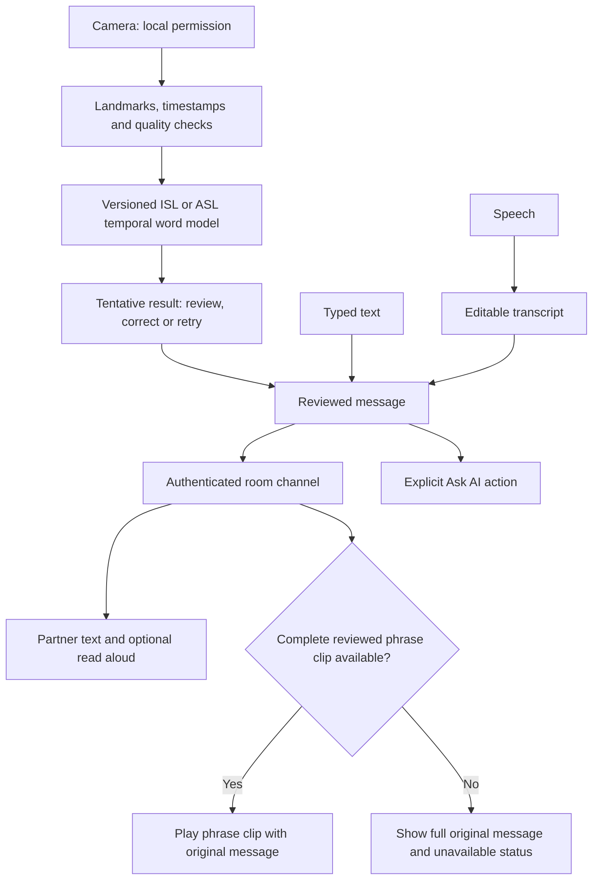

# SignBridge: project research and recommended direction

Research checked: **10 October 2026**. Intended constraints: one software month, the existing Windows laptop, Android Chrome, free pilot hosting, and a developer who does not yet know a sign language. This report combines local experiment records with primary research, official dataset distributions and vendor documentation. Recommendations are proposals; published results are not SignBridge results.

## Decision

Continue the project, with a narrower first claim: **an ISL conversation prototype that recognises an explicitly supported vocabulary, lets people review uncertain messages, delivers text and optional speech, and offers reviewed complete-phrase sign replies where available.** Keep ASL as a separate language and research track. Preserve the long-term goal of continuous conversation translation, but evaluate it separately from isolated-word recognition.

The immediate bottlenecks are data compatibility, unseen-signer performance and linguistic validation. Another GitHub model, more interface controls or an AI key will not independently solve them. The next month should establish trustworthy two-way communication within a small supported scope.

## 1. What the current project actually establishes

These are recorded local findings, not new tests performed during this research request.

| Area | Evidence available | What remains unproved |
| --- | --- | --- |
| Camera → joints → word | An archived/camera coordinate mismatch was isolated. The corrected local ISL v2 contract accepted HELLO from the original reference video at 0.97705, using unchanged weights and thresholds. | Natural signing by unfamiliar people. This replay was not a fluent signer's live webcam turn. |
| Other words | The corrected THANK YOU replay produced the right highest label, but its 0.72423 score remained below the 0.95 acceptance threshold. | Consistent useful recognition beyond the reference success. |
| Model experiments | Historical three-seed ISL results: full-joint GRU top-1 89.6%, but correctly accepted coverage only 26.2%. No candidate passed every release gate. | Safe automatic translation, continuous sentences, or comparable live-camera accuracy. |
| Partner delivery and speech | Automated integration exercises inference, reviewed messages, HTTP/WebSocket delivery and speech requests; repeated HELLO messages remain distinct. | Physically heard audio and an actual two-device signing conversation. Mocked speech callbacks do not establish audibility. |
| Reply signs | Local saved clips, coverage planning and missing-word handling exist. | A shared, permitted and linguistically reviewed phrase library, or arbitrary text → grammatical ISL/ASL. |
| Public service | Deployment records document the Render pilot. Public builds exclude research recognition artifacts. | Deploying the website alone does not enable the laptop's local word models. This research did not recheck live service health. |

Local evidence: [recognition replay](C:/Users/adjay/Downloads/signbridge/docs/recognition-replay-2026-10-09.md), [joint-model study](C:/Users/adjay/Downloads/signbridge/docs/graph-model-implementation-2026-10-04.md), [latest reference-informed changes](C:/Users/adjay/Downloads/signbridge/docs/isl-reference-improvements-2026-10-09.md), [sign/text/voice test limits](C:/Users/adjay/Downloads/signbridge/docs/sign-only-text-voice-test-2026-10-09.md).

The GRU27/full75 comparison changed resampling, validity handling and normalisation. The graph/full75 GRU comparison used the same arrays and statistics, but had different model capacities and bounded optimisation. These experiments predate the coordinate audit and do not establish that graph architectures are intrinsically inferior. The separate strict ASL signer study had very low accepted coverage; it reinforces the need to evaluate unfamiliar signers rather than recycle archive accuracy as a product claim.

## 2. Is the connected-joints idea valid?

**Yes: temporal landmark data is a credible representation.** In August 2026 Google DeepMind announced SL2T, which translates landmark sequences directly to text. It reports training on more than 100,000 hours across over 50 sign languages; initial product availability is ASL → English in Gboard and Live Transcribe on Pixel 11. This is strong precedent for the user's idea, and also demonstrates the scale separating a broad translator from a small word classifier. No downloadable weights or integration API were established in the official announcement checked. Do not assume SL2T is exposed through Gemini's API. [Google DeepMind announcement](https://deepmind.google/blog/putting-sign-language-ai-into-users-hands/)

The accompanying report describes 130 two-dimensional face/body/hand points and explicitly discusses lost tongue detail, environmental context and depth/contact information. Its intended release scope includes informal one-to-one exchanges. Coordinates reduce visual detail and bandwidth, but do not establish anonymity or complete linguistic information. [AISLAC joint impact report](https://storage.googleapis.com/deepmind-media/DeepMind.com/Blog/putting-sign-language-ai-into-users-hands/aislac-joint-impact-report-for-sl2t-1-0.pdf)

Three different tasks must stay distinct:

- **Tracking:** locating hands, fingers, body and face. It does not identify meaning.
- **Isolated recognition:** choosing a supported word from a bounded sign clip.
- **Continuous translation:** interpreting transitions, sign boundaries, repeated signs, spatial reference, facial grammar and fingerspelling into another language.

Preserve movement over time, both hands, handshape and hand position relative to the body. Normalising each hand alone can discard meaningful mouth/chest/location differences. Face and selected image features are candidates for later controlled experiments, not automatic accuracy upgrades. Multilingual translation research also treats continuous translation as a sequence-level learning problem. [Scaling Sign Language Translation, NeurIPS 2024](https://papers.nips.cc/paper/2024/hash/ced76a666704e381c3039871ffe558ee-Abstract-Conference.html)

## 3. Which models are practical?

| Option | Verified availability / limits | Recommended use |
| --- | --- | --- |
| Existing GRU; existing LSTM comparator | The GRU has local evidence. A separate GRU75/LSTM75 comparison runner is already implemented, but no real-data LSTM fit is established. New study preflight requires coordinate provenance; historical unannotated arrays cannot pass it. | First research priority: complete canonical data preparation and compare both 75-joint variants under identical conditions. Keep the current 27-joint model as a separate deployment baseline. |
| OpenHands recurrent and graph models | Apache-2.0 code and public INCLUDE/WLASL checkpoint assets. INCLUDE recurrent configuration uses 27 selected MediaPipe joints and shoulder normalisation. Repository says it is no longer actively maintained. | One external reproducibility control, after matching its exact inputs, label order and dataset terms. Not a sentence translator or browser-ready promise. [Official models](https://openhands.ai4bharat.org/en/latest/instructions/models.html), [repository](https://github.com/AI4Bharat/OpenHands) |
| Siformer | Author code provides skeleton Transformer, missing-data and hand-refinement research. A named pretrained checkpoint was not established in the inspected project material. | Later architectural reference if error analysis justifies reproduction. Published ASL benchmark results do not establish ISL performance. [Paper](https://arxiv.org/abs/2503.20436), [implementation](https://github.com/mpuu00001/Siformer) |
| Uni-Sign | Author release includes continuous-ASL pose-only checkpoints, approximately 1.19 GB each, with CC-BY-NC-4.0 model-card terms. Its 69 selected RTMPose points differ from MediaPipe inputs; code/demo setup relies on GPU tooling. | Separate continuous-ASL research experiment after licence and input investigation. Laptop/browser/free-host suitability is unmeasured; no ISL capability is established. [Author models](https://huggingface.co/ZechengLi19/Uni-Sign), [paper](https://proceedings.iclr.cc/paper_files/paper/2025/file/260a14acce2a89dad36adc8eefe7c59e-Paper-Conference.pdf) |

For the first release, retain a compact browser recogniser. ONNX Runtime Web supports WASM and GPU execution, but GPU operator support and device availability vary. Measure the whole tracking/inference/UI pipeline before choosing an acceleration backend. Existing millisecond classifier timings on prepared tensors do not measure webcam latency. [ONNX Web performance guidance](https://onnxruntime.ai/docs/tutorials/web/performance-diagnosis.html), [Web runtime overview](https://onnxruntime.ai/docs/tutorials/web/)

Gemini Live is useful as an interaction reference and optional assistant. Its current live-video guide specifies a maximum of one image frame per second. **Inference:** that endpoint is a poor default for fine, rapid signing. This is not a statement about every Gemini uploaded-video path, and the guide does not establish a validated ISL interpreter. Keep assistant replies downstream of explicitly confirmed meaning. [Live API capabilities](https://ai.google.dev/gemini-api/docs/live-api/capabilities)

## 4. Data that can realistically help

| Dataset | What it supplies | Project decision |
| --- | --- | --- |
| INCLUDE / INCLUDE-50 | Official release: 4,292 isolated ISL clips across 263 classes; INCLUDE-50 has 958 clips. Full video distribution is about 56.8 GB. Dataset card declares CC BY 4.0. | Best immediate source for auditing the current corpus and selecting a small vocabulary. The Chennai recordings do not represent every regional variant. [Official release](https://zenodo.org/records/4010759), [dataset card](https://huggingface.co/datasets/ai4bharat/INCLUDE/blob/main/README.md) |
| CISLR | Original paper: 4,765 ISL words, 7,050 videos and 71 signers, built for sparse/prototype recognition. Current HF metadata says AFL-3.0; official repository describes dataset terms as CC-BY-NC. | Interesting broader lexical reference, but very sparse per word. Resolve inconsistent terms before redistribution; code licensing does not establish dataset rights. [Paper](https://aclanthology.org/2022.emnlp-main.707.pdf), [repository](https://github.com/Exploration-Lab/CISLR), [current card](https://huggingface.co/datasets/Exploration-Lab/CISLR) |
| iSign | Original paper: 118,228 ISL video–text pairs and approximately 252 hours, across several tasks; includes earlier ISLTranslate/CISLR material. A unique signer count was not established. Current v1.1 distribution is gated, about 228 GB, CC-BY-NC-SA 4.0, and includes pose/confidence files. | Main longer-term ISL sequence-to-text research candidate. Do not add overlapping predecessor counts or treat its pose data as the existing model's input contract. [Paper](https://aclanthology.org/2024.findings-acl.643.pdf), [current distribution](https://huggingface.co/datasets/Exploration-Lab/iSign) |
| ASL Citizen | Official v1.0: 83,399 videos, 2,731 ASL signs, 52 participants, with signer-independent partitions. Dataset terms restrict use and redistribution. | Strong ASL evaluation-design reference; separate from ISL and from public reply-clip permissions. [Description](https://www.microsoft.com/en-us/research/project/asl-citizen/dataset-description/), [terms](https://www.microsoft.com/en-us/research/project/asl-citizen/dataset-license/) |

Two concrete audit issues matter before training:

1. INCLUDE's HF metadata lists 3,816 + 425 + 1,009 rows, totalling 5,250, whereas the original release describes 4,292 clips. This is a documentation/count discrepancy, **not proof of leakage**. Reconcile unique source IDs, duplicates, missing files and partitions. [Dataset metadata](https://huggingface.co/datasets/ai4bharat/INCLUDE/blob/main/README.md)
2. iSign recommends grouping all segments of a source `video_id` into one partition. That prevents source-segment leakage but does not itself establish signer independence. Its paper reports human validation on a sample of 593 pairs and excludes two-signer conversations. [Current split guidance](https://huggingface.co/datasets/Exploration-Lab/iSign), [paper](https://aclanthology.org/2024.findings-acl.643.pdf)

For later ASL work, [WLASL](https://github.com/dxli94/WLASL) offers isolated-word benchmarks with restricted dataset terms and source-availability issues; [How2Sign](https://how2sign.github.io/) offers continuous ASL and keypoints under noncommercial terms. Neither should be downloaded wholesale for this immediate pilot. Dataset access, code permission, trained-model distribution and public video playback are separate checks.

## 5. Reverse replies and accessibility

Start with **complete, reviewed phrase videos**. A clip for a full intended message can preserve grammar and context better than choosing English-order word animations. Isolated clips can remain a clearly labelled dictionary aid. The WFD/WASLI avatar statement explains why lexical correspondence alone does not convey signed-language grammar and meaning; it is foundational 2018 guidance, not a 2026 model benchmark. [WFD/WASLI statement](https://wfdeaf.org/wp-content/uploads/WFD-and-WASLI-Statement-on-Avatar-FINAL-14032018-Updated-14042018.pdf)

Suggested initial phrase intents: greeting, asking someone to repeat, saying a message was not understood, confirming understanding, and arranging a simple meeting. These are proposed intents; actual ISL wording and regional variants need fluent review. If a whole-message clip is unavailable, retain the complete message and state that limitation. Never drop “not,” times or unsupported words and imply successful translation.

Each clip needs language, intended meaning/context, variant where relevant, source/licence, signer permission, reviewer and review status. Deaf-led participation and informed consent are supported by EUD's current AI framework. Publicly viewable media are not automatically a permitted training or reply library. [EUD AI publications, July 2025](https://eud.eu/new-eud-publications-on-artificial-intelligence-and-sign-language/)

Use one conversation entrance: **Send using Type / Speak / Sign; Receive using Text / Voice / Sign video**. Keep advanced training tools under Tools. Show the progression from camera ready → tracking → tentative word → review → delivered, because these states have different meanings. Provide clear Repeat / I didn't understand actions, large replay controls and an unobstructed face/hands/torso view.

Do not assume that someone who can see can comfortably read the output. Test their understanding directly. W3C guidance notes that preferences for sign and captions vary. Keyboard access, focus, reflow and programmatic status messages also need verification. Announce recognition/delivery status without stealing focus. Move focus into review following an intentional user action or context change; repeated predictions must not repeatedly move it. [W3C sign-language media guidance](https://www.w3.org/WAI/media/av/sign-languages/), [WCAG 2.2](https://www.w3.org/TR/WCAG22/), [status-message guidance](https://www.w3.org/WAI/WCAG22/Understanding/status-messages.html)

## 6. Novelty: what can honestly be claimed?

The broad two-direction idea already has commercial precedents. Hand Talk advertises English → ASL and Portuguese → Libras from text/audio, with replay and speed controls. Sign-Speak advertises ASL-video captions and speech → ASL avatar output. These are vendor descriptions, not independently comparable accuracy evidence. [Hand Talk](https://www.handtalk.me/en/app/?iframe=yes), [Sign-Speak FAQ](https://www.sign-speak.com/faq)

The useful differentiation hypothesis is **an affordable ISL-focused conversation flow that makes uncertainty, incomplete coverage, correction and delivery understandable**. Existing message revisions and repair tools are relevant. This is not yet a demonstrated unique invention. A comparative usability study and broader prior-art review would be needed for stronger originality claims.

Measure value through successful communication: did the partner understand the intended meaning, could an error be repaired, and did the app reduce effort compared with typing or an unassisted video call? A long feature list is weaker evidence than completing these tasks with actual users.

## 7. Recommended architecture

Live partner video remains available independently of recognition. Model selection must bind language, joint order, extractor/version, coordinate units/axes, mirroring, confidence/missing masks, timing/resampling and label mapping. Keep raw capture separate from model-space transformation and establish parity on identical numeric inputs. Do not reuse the corrected ISL scale for an unaudited ASL model.

Training stays offline. Camera inference can stay on the device when a model is eligible; publishing a model requires both evaluation and distribution checks. Keep room routing independent of Gemini. Speech input should pause while app read-aloud output plays to avoid echo capture. Receiving a reviewed human message and asking the assistant for a new answer are distinct actions.

## 8. Research protocol and release evidence

**Proposed experiment, not achieved results:**

1. Freeze the current model, hashes and thresholds as a reference. Audit the existing 49-class corpus and select **10–20** useful, sufficiently represented ISL signs; the final list depends on data and fluent review.
2. Implement and verify canonical data conversion before the existing LSTM preflight. A declaration alone is not proof that arrays were transformed correctly.
3. Split by signer and recording session where identities exist; keep every crop, frame and augmentation of a recording together. If signer identity is unavailable, label that limitation and do not call the result signer-independent.
4. Compare GRU75 and LSTM75 on the same joint representation, samples, preprocessing, frame budget, tuning budget and seeds. Evaluate the existing GRU27 separately as a deployment reference; a 27-versus-75 comparison cannot isolate architecture. Optional graph or hand-image features follow a failure audit. Keep a new final test untouched until selection is frozen.
5. Include unknown signs, idle hands, face touching, partial hands, poor light, repetitions and interrupted captures. Record why each failure happened: tracking, coordinates, timing, unfamiliar signer, confusion or unsupported vocabulary.
6. Test the complete Windows and Android pipeline and then actual two-device, different-network conversations. Evaluate sign understanding separately from room transport and speech playback.

Report top-1/macro F1 and per-word confusion, but also **accepted precision**, **accepted coverage**, and **correctly accepted coverage**. A model that abstains on almost everything can have apparently good accepted precision while remaining unusable. Include unknown-sign false acceptance, idle false words per minute, repeated-sign recall, and full-pipeline p50/p95 latency.

Retain the existing proposed model gate as a starting point: at least 95% accepted-known precision, at least 60% correctly accepted coverage and at most 5% unknown false accepts. These are project targets, not achieved guarantees. Publish denominators and confidence intervals; tiny samples cannot establish these rates. Calibrate on validation only. Softmax confidence is not a proven probability of correctness. [Calibration research](https://proceedings.mlr.press/v70/guo17a.html), [selective classification research](https://proceedings.neurips.cc/paper_files/paper/2017/hash/4a8423d5e91fda00bb7e46540e2b0cf1-Abstract.html)

For user testing, a fluent signer and a non-signer should complete short two-way tasks and explain what each understood without seeing the expected answer. Record wrong meanings, missing coverage, repairs, time and help needed. The developer imitating a reference sign can test mechanics; it cannot establish linguistic correctness or community usefulness.

## 9. One-month sequence and dependencies

| Period | Priority | Reviewable result |
| --- | --- | --- |
| Week 1 | Corpus/coordinate/split audit; narrow supported vocabulary; identify a fluent reviewer. | Data manifest, compatible conversion/parity evidence and untouched evaluation plan. |
| Week 2 | Matched GRU75/LSTM75 experiment after canonical preparation; unknown/repetition tests; actual browser profiling. | Reproducible comparison and an honest promote/reject decision. |
| Week 3 | Reviewed whole-phrase reply library; clear review/delivery flow; two-way task rehearsal. | Every available clip has provenance; unavailable meanings stay visible. |
| Week 4 | Physical devices and networks, relay, permissions, reconnect and accessibility testing; fluent-user tasks where available. | Recorded evidence, failure list, supported-scope demo and limitations. |

**Developer work:** manifests, canonical preparation, controlled comparisons, latency instrumentation, phrase metadata and conversation testing. **User contribution:** help locate a Deaf/ISL-fluent collaborator through college or a local organisation, approve appropriate data access, and participate in physical phone/laptop tests. No outbound contact or gated-dataset acceptance was performed for this research.

If no fluent collaborator is available, continue offline tests using permitted public material and present the result as a reference-video research prototype. Do not substitute beginner imitation for ground truth. If a candidate fails the model gates, retain reviewed typing, speech and direct video and document the failed hypothesis. Continuous ISL translation and generated signing remain later milestones.

## 10. Hosting and cost realism

Render Free is suitable for a pilot: current documentation describes idle spin-down after 15 minutes without inbound activity, roughly a minute to wake, 750 free instance hours per workspace/month, ephemeral storage and possible restarts. Current in-memory room history therefore cannot be promised to survive a server restart. Free-tier resource and bandwidth limits must be respected. [Render Free documentation](https://render.com/docs/free)

Metered Open Relay advertises 20 GB of free relay traffic per month and requires an account/credentials. The allowance is finite; forced-relay, different-network testing is still required. Keep text communication usable if media cannot connect. Hosting does not remove recognition or sign-asset gaps. [Open Relay](https://www.metered.ca/tools/openrelay/)

No new hardware is necessary to test this software scope. Braille hardware remains a separate later project. This research added a report only: no model downloads, new fits, application changes, cloud changes or new claims of real-user success.
