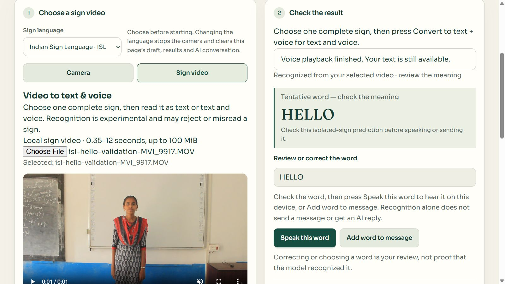

# Sign video to text and voice — 22 October 2026

Sign Workspace now has a **Camera / Sign video** input choice. A local video can be processed with **Convert to text + voice** or **Convert to text**. Its recognized word appears in the existing result panel, with the same editing, explicit replay and reviewed-message controls as camera input.

An actual browser run of the existing permitted ISL HELLO reference produced **HELLO** and the browser speech service reported completed playback. This is a demonstrated known-reference flow, not a new trained model, an unseen-video evaluation, proof of sound at the physical speaker, or evidence that arbitrary webcam signs now work.

## Use it

1. Open [Sign Workspace](http://127.0.0.1:5174/#trained-sign), select ISL or ASL, and choose **Sign video**.
2. Choose a video containing one complete supported sign: 0.35–12 seconds, at most 100 MiB. Both shoulders and signing hands should remain visible. Browser codec support still applies.
3. Press **Convert to text + voice**. Read the tentative result and correct it if needed. The file name is displayed for your reference but is never used to select a prediction.
4. **Speak this word** repeats the displayed/reviewed word. **Add word to message** uses it in a reviewed message; sending to a partner or asking AI remains explicit.

Camera input remains available through **Camera → Start camera + read aloud**. Live signing recognition remains unreliable and is not established by this video demonstration.

## Implementation

- The new `SignVideoInput` uses the existing Tasks Holistic loader at eight source samples per second. It seeks and decodes each sampled frame, so slow processing does not skip source timestamps. A fresh tracker is released after each turn. No padded poses or expected labels are supplied to the recognizer.
- Captured frames enter the same `useWordRecognitionModel` and `recognizeTurn` path as the camera. Model weights, coordinate transformations, confidence threshold (0.95) and separation requirement (0.30) were not changed.
- An accepted legacy-model prediction triggers the existing local speech service only when the user requested voice. Unclear/invalid results stay silent. Browser speech errors retain the text and show a retry explanation.
- Switching input stops the live camera, clears the previous tentative result and cancels old voice/inference while retaining the user's composed draft. Video source changes, cancellation, Escape, unavailable models and unmount release the owned tracker and object URLs; late callbacks cannot restore cancelled results.
- Asynchronous video inference is exempt from camera-off/freshness cancellation. A source change still invalidates it.
- Videos remain local, in memory. No video upload, Gemini interpretation, automatic messaging, sample save or retraining occurs. Uploaded-video poses do not enter the webcam training form.

## Actual browser evidence

The selected development reference was `F:\Downloads\signbridge\.training-data\replay\isl-hello-validation-MVI_9917.MOV`, a previously examined INCLUDE validation example. Attribution: Sridhar, Ganesan, Kumar and Khapra (2020), [official dataset card](https://huggingface.co/datasets/ai4bharat/INCLUDE/blob/main/README.md), CC BY 4.0. The file and model were not changed for this check.

| Measurement | Observed |
|---|---|
| Source video SHA-256 | `61a50323776fe04f732aba8668a1ea8fac09c17d387af26c78a94412f003e7ff` |
| Active ISL model SHA-256 | `55c23fffe387944a102c804676ae91aa7276781d598b7adaf03f0115234acdd9` |
| Source duration | 1,960 ms |
| Measured samples | 16; all with hands and shoulders |
| Largest source-time gap | 125 ms |
| Accepted word | HELLO |
| Model score | 0.9836577181667145; this is not accuracy |
| Separation from runner-up | 0.9778200244998542 |
| Visible text | HELLO in the result and review field |
| Voice status | Browser reported playback finished |

The actual scalar [recognition report](sign-video-hello-report-2026-10-22.json) was downloaded through the product UI. No expected label, file name or source metadata entered the predictor. Repeated runs of the same development video checked the final controls and layout; these are software regression checks, not independent accuracy samples. Physical speaker audibility remains unconfirmed.

## Verification and remaining boundary

Automated coverage includes shared text/voice routing, text-only output, silent rejected results, draft retention, asynchronous camera-off handling, stale-result suppression, invalid videos, replacement/cancellation, model loss and resource cleanup. These tests use simulated model/media results; the measured reference-video run above is separate.

Final `npm run check` passed 382 Node tests and 530 UI tests across 41 files, followed by the local production/PWA build. The final public build also passed and `dist/models` was absent. The existing large JavaScript chunk warning remains. No Python training code changed in this video-input update.

Final app checks and public build logs are local: `.training-data/replay/sign-video-check-2026-10-22.log` and `.training-data/replay/sign-video-public-build-2026-10-22.log`. The public build excludes research weights and therefore cannot provide this local trained recognition without separately approved model distribution.

The [13 October study](tasks-video-training-results-2026-10-13.md) still governs model promotion: both new candidates failed its requirements. This update makes the input/output flow accessible and demonstrates one existing reference, while broader sign recognition and real-device communication acceptance remain unfinished.
